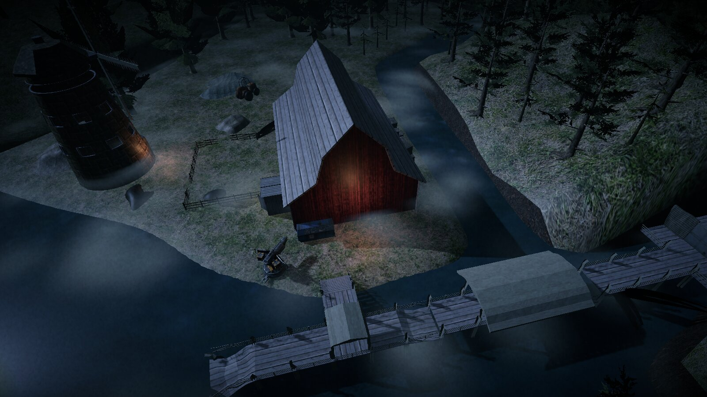

# 🧟 Horror-Defense

Um jogo de **Tower Defense** focado em uma atmosfera de **Horror**, desenvolvido na Unity. Enfrente ondas de inimigos aterrorizantes construindo e gerenciando suas defesas.

Seres gigantes, parecidos com aracnídeos, invadem uma fazenda abandonada à noite. Posicione suas torres e impeça que eles destruam a base.



## 🛠️ Tecnologias
* **Engine:** Unity 6000.5.10f1, com URP
* **Linguagem:** C#
* **Entrada:** Input System

## 👥 Integrantes
* **Gregori Yago Kempf** (GregKmpf/204034) - Dev
* **Arthur Benedetti** (NyuuDev) - Dev
* **Guilherme Grosselli** (grosselliguilherme) - Dev

## 🎮 Baixar o Jogo

Builds da `main` no commit [`8c6a63e`](https://github.com/GregKmpf/Horror-Defense/commit/8c6a63e):

| Sistema | Download | Como abrir |
|---|---|---|
| Windows | [Windows.zip](https://drive.google.com/file/d/1UBEektrAGNDCISWeeoX_gIDmzKmmaKTo/view?usp=sharing) | Extraia o `.zip` e rode `Windows/HorrorDefense.exe` |
| Linux | [Linux.tar.gz](https://drive.google.com/file/d/1C1jouVm5jD21cnipmZU1BM3oVLd_VZA3/view?usp=sharing) | Extraia com `tar xzf Linux.tar.gz` e rode `Linux/HorrorDefense.x86_64` |

## 🚀 Como Executar o Projeto

1. Clone o repositório:
   ```bash
   git clone https://github.com/GregKmpf/Horror-Defense.git
   ```
2. Abra a pasta no Unity Hub com a versão **6000.5.10f1** do editor.
3. O projeto abre na cena `StartMenu`, a primeira do Build Settings. Aperte **Play**, clique em **Jogar** e escolha **Fácil** ou **Difícil**.

Ao rodar a cena `AbandonedFarm` direto, sem passar pelo menu, o jogo usa a dificuldade **Fácil**.

### Controles

| Tecla | Ação |
|---|---|
| `W` `A` `S` `D` ou setas | Move a câmera pelo mapa. Com `Shift`, mais rápido |
| Arrastar com o botão do meio | Arrasta o mapa |
| Arrastar com o botão direito | Gira a câmera em volta do ponto que ela olha e muda a inclinação |
| `Q` / `E` | Gira a câmera para a esquerda / direita |
| Scroll do mouse | Zoom em direção ao cursor |
| `Home` | Volta a câmera para a posição inicial |
| Clique esquerdo num anel no chão | Abre o menu daquela posição: construir uma torre, ou trocar o alvo e vender a que já está lá |
| Clique direito, sem arrastar | Fecha o menu |
| `1x` / `2x` (canto inferior direito) | Velocidade do jogo |
| Chamar agora (abaixo da onda) | Começa a próxima onda sem esperar |
| `Esc` | Pausa: continuar, reiniciar ou voltar ao menu |
| `Música` / `Sons` (acima da velocidade) | Liga e desliga a música e os efeitos sonoros. A escolha fica salva |
| `M` | Liga e desliga a música |

## 📁 Estrutura

| Pasta | Conteúdo |
|---|---|
| `Assets/Scenes` | `StartMenu` (menu), `AbandonedFarm` (o jogo) e `Teste2.0` (testes) |
| `Assets/Scripts` | Código, separado por sistema: `Audio`, `Camera`, `Enemies`, `Environment`, `Game`, `Paths`, `Turrets`, `UI` e `Waves` |
| `Assets/Difficulties` | As dificuldades `Easy` e `Hard`, com as ondas de cada uma |
| `Assets/Enemies` | Inimigos e o modelo para criar novos. Detalhes em [`Assets/Enemies/README.md`](Assets/Enemies/README.md) |
| `Assets/Turrets` | Torres, projéteis e efeitos. Detalhes em [`Assets/Turrets/README.md`](Assets/Turrets/README.md) |
| `Assets/Environment` | A fazenda e a atmosfera noturna (céu, névoa, materiais) |
| `Assets/UI` | Interface durante o jogo (`GameUI.prefab`). Detalhes em [`Assets/UI/README.md`](Assets/UI/README.md) |
| `Docs/Screenshots` | Imagens usadas nos PRs |

## 📦 Entrega

* **Executável do jogo:** [Windows](https://drive.google.com/file/d/1UBEektrAGNDCISWeeoX_gIDmzKmmaKTo/view?usp=sharing) e [Linux](https://drive.google.com/file/d/1C1jouVm5jD21cnipmZU1BM3oVLd_VZA3/view?usp=sharing). Como abrir em [Baixar o Jogo](#-baixar-o-jogo)
* **Vídeo demonstrativo:** _link pendente_

## 📋 Requisitos do Trabalho

Requisitos do Trabalho Prático de CCC300 – Computação Gráfica e Realidade Virtual (2026/2), com a situação de cada um em **24/11/2026**.

| Legenda | Significado |
|---|---|
| ✅ | Feito e já está em `main` |
| 🔀 | Feito, mas ainda fora da `main` (em outra branch ou em PR aberto) |
| 🟡 | Parcial: existe, mas não atende ao requisito por completo |
| ❌ | Não iniciado |

### Resumo da situação

* **Feito:** cenário noturno, base, três entradas de inimigos com caminhos marcados no chão, seis tipos de torre, quatro tipos de inimigo, projéteis com detecção de colisão, ondas, duas dificuldades, tempo limite, vitória e derrota com telas de fim, menu inicial com escolha da dificuldade, ranking e informações, menu de pause, HUD, construção de torres pelo jogador com dinheiro, controle de velocidade, câmera livre, efeitos visuais, música e efeitos sonoros, e build para Windows e Linux.
* **Não iniciado:** vídeo.

### Jogo e menu

| Requisito | Status | Observação |
|---|---|---|
| Tower Defense 2D ou 3D na Unity, em trio | ✅ | Jogo 3D |
| Plataforma PC ou mobile (livre) | ✅ | PC, com builds para Windows e Linux: [Baixar o Jogo](#-baixar-o-jogo) |
| Menu para iniciar o jogo | ✅ | Cena `StartMenu`, com Jogar, Ranking, Sobre e Sair: [#10][pr10], [#23][pr23] |
| Escolha do nível de dificuldade pelo menu | ✅ | Jogar abre um painel com Fácil e Difícil, que passa a dificuldade escolhida ao `GameManager`: [#23][pr23] |
| Ranking simples, mostrado no menu | ✅ | As 5 melhores partidas de cada dificuldade, salvas no `PlayerPrefs` (`Ranking`). Os pontos são a soma das recompensas dos inimigos mortos, e o empate fica com o menor tempo. A tela de fim mostra os pontos e a posição da partida: [#23][pr23] |
| Informações sobre o jogo no menu | ✅ | Painel Sobre, com a história e os integrantes: [#10][pr10] |

### Níveis de dificuldade e ondas

| Requisito | Status | Observação |
|---|---|---|
| Uma ou mais ondas de inimigos | ✅ | `WaveManager`: [#8][pr8]. Cada grupo de uma onda vem de uma entrada, ou de todas, alternando: [#15][pr15] |
| Pelo menos 2 níveis de dificuldade | ✅ | Fácil e Difícil (`Assets/Difficulties`): [#8][pr8] |
| Pelo menos 5 inimigos no nível mais simples | ✅ | Fácil: 3 ondas, com 5, 10 e 20 inimigos (35 no total) |

| Dificuldade | Ondas | Inimigos | Vida | Velocidade | Tempo limite | Antes da 1ª onda | Entre ondas | Dinheiro inicial |
|---|---:|---:|---:|---:|---:|---:|---:|---:|
| Fácil | 3 | 35 | ×1,0 | ×1,0 | 240 s | 15 s | 8 s | $450 |
| Difícil | 4 | 83 | ×1,2 | ×1,1 | 300 s | 10 s | 5 s | $450 |

### Ambiente e área de jogo

| Requisito | Status | Observação |
|---|---|---|
| Área de jogo limitada | ✅ | Fazenda Abandonada: [#1][pr1], restaurada no [#5][pr5] e corrigida no [#11][pr11] |
| Base a ser defendida | ✅ | `Objetivo`, com 100 de vida: [#5][pr5]. Um trigger nas portas norte do celeiro marca onde os inimigos chegam: [#19](https://github.com/GregKmpf/Horror-Defense/pull/19) |
| Um ou mais pontos de entrada | ✅ | Três: o rio a leste da ponte, o platô do trailer (oeste) e a mata ao norte: [#15][pr15] |
| Caminho até a base | ✅ | Um `EnemyPath` por entrada, em `EnemyPaths`, todos até as portas norte do celeiro. Um rastro vermelho no chão mostra cada um, e a ponte tem um passadiço invisível para os inimigos andarem sobre ela: [#15][pr15] |
| Posições para as estruturas defensivas | ✅ | 12 `TurretSlot` ao longo dos três caminhos, cada um marcado no chão por um anel tracejado: [#16][pr16]. Os 4 primeiros vieram do [#6][pr6] |
| Cenário com pelo menos o tamanho de 30 inimigos enfileirados | ✅ | Rotas de 144 m (ponte), 96 m (oeste) e 75 m (norte), e corpo do Mimic com cerca de 1 m (collider). As pernas o deixam bem mais largo, vale confirmar a escala visualmente |

### Estruturas defensivas

| Requisito | Status | Observação |
|---|---|---|
| Pelo menos 2 tipos com comportamentos distintos | ✅ | 6 tipos: Cannon, Rocket Pod, Artillery, Minigun, Heavy e Shock Generator: [#3][pr3], [#6][pr6] |
| Detectar inimigos por alcance | ✅ | [#3][pr3], [#6][pr6] |
| Selecionar um alvo | ✅ | Prioridades First, Last, Closest e Strongest: [#3][pr3], [#6][pr6] |
| Atacar, causar dano e aguardar um intervalo | ✅ | [#3][pr3], [#6][pr6] |
| Jogador posiciona ou ativa as estruturas durante o jogo | ✅ | Clicando num anel no chão, o jogador escolhe a torre e paga com o dinheiro ganho matando inimigos. Também escolhe o alvo preferido de cada torre e pode vendê-la: [#17][pr17] |

### Inimigos

| Requisito | Status | Observação |
|---|---|---|
| Seguir um caminho predefinido até a base | ✅ | `EnemyMovement`: [#2][pr2], configurado na cena pelo [#5][pr5]. Três caminhos desde o [#15][pr15] |
| Ter vida e receber dano | ✅ | `Enemy`: [#2][pr2] |
| Ser removido com vida zero | ✅ | `Enemy`: [#2][pr2] |
| Causar consequência ao chegar à base | ✅ | Tira vida do `Objetivo`: [#5][pr5] |
| Quantidade e características variam com a dificuldade | ✅ | Número e tipos de inimigos, e multiplicadores de vida e velocidade: [#8][pr8], [#20](https://github.com/GregKmpf/Horror-Defense/pull/20). O Fácil tem 1 Brute, o Difícil tem 8 |
| Pelo menos 2 comportamentos distintos (recomendado) | ✅ | Quatro tipos de Mimic: **Crawler** (pequeno, rápido e frágil), **Mimic**, **Brute** (grande, lento e resistente) e **Matriarca** (enorme e muito lenta, chega no fim da última onda). Cada um tem vida, velocidade, recompensa, dano à base, tamanho, pernas e cor próprios: [#20](https://github.com/GregKmpf/Horror-Defense/pull/20). Detalhes em [`Assets/Enemies/README.md`](Assets/Enemies/README.md#mimic-types) |

### Ataques e projéteis

A torre só mira e dispara. O dano vem do projétil (`Assets/Scripts/Turrets/Projectile.cs`), e só quando ele colide com o inimigo. Detalhes em [`Assets/Turrets/README.md`](Assets/Turrets/README.md).

| Requisito | Status | Observação |
|---|---|---|
| Projétil criado a partir da estrutura | ✅ | Cada disparo cria um projétil no cano da torre, um por alvo. Cinco tipos: Shell, Bullet, Heavy Shell, Rocket e Bolt: [#6][pr6] |
| Projétil se desloca até o alvo | ✅ | Segue o alvo enquanto ele vive. Se o alvo morrer antes, continua em linha reta: [#6][pr6] |
| Projétil detecta colisão com o inimigo | ✅ | `OnTriggerEnter` entre o collider do projétil e o `SphereCollider` do inimigo. A camada `Projectile` só colide com a camada `Enemy`: [#6][pr6] |
| Projétil causa o dano | ✅ | Só no impacto. O dano em área usa `Physics.OverlapSphere` na camada `Enemy`: [#6][pr6] |
| Projétil é destruído ao acertar ou sair da área válida | ✅ | Ao acertar, ou ao se afastar mais de 1,25 × o alcance da torre (ou após 4 s): [#6][pr6] |

### Detecção de colisão

| Requisito | Status | Observação |
|---|---|---|
| Impacto entre projéteis e inimigos | ✅ | `Projectile.OnTriggerEnter`: [#6][pr6] |
| Chegada dos inimigos à base | ✅ | `Objetivo.OnTriggerEnter` entre o `BoxCollider` (trigger) nas portas norte do celeiro e o `SphereCollider` do inimigo. A camada `Base` só colide com a camada `Enemy`. Se um inimigo chegar ao fim do caminho sem tocar o trigger, ele conta mesmo assim e o Console mostra um aviso: [#19](https://github.com/GregKmpf/Horror-Defense/pull/19) |
| Destruição ou remoção dos inimigos | ✅ | Por vida zero, e o dano só vem do impacto do projétil: [#6][pr6] |

### Vitória e derrota

O `GameManager` ([#8][pr8]) controla a partida. Ao terminar, ele congela o tempo e dispara o evento `GameEnded`, que abre a tela de fim com o resumo da partida e os botões para jogar de novo ou voltar ao menu ([#17][pr17]).

| Requisito | Status | Observação |
|---|---|---|
| Vitória ao resistir às ondas ou cumprir a missão | ✅ | Vence ao acabarem todas as ondas, com tela de vitória: [#17][pr17]. Inimigos que chegam à base também contam para acabar a onda, mas cada um tira vida dela |
| Derrota quando a vida da base chega a zero | ✅ | Com tela de derrota: [#17][pr17]. Cada inimigo que chega tira dos 100 de vida da base: 5 (Crawler), 10 (Mimic), 25 (Brute) ou 50 (Matriarca). Sem torres, a base cai na 2ª onda nas duas dificuldades: [#21](https://github.com/GregKmpf/Horror-Defense/pull/21) |
| Tempo máximo para a missão, com derrota ao esgotar | ✅ | 240 s no Fácil e 300 s no Difícil, que tem uma onda a mais, com derrota ao esgotar. As ondas levam cerca de 145 s e 220 s. O tempo restante fica no HUD e fica vermelho nos últimos 30 s: [#17][pr17], [#21](https://github.com/GregKmpf/Horror-Defense/pull/21) |

#### Balanceamento

Testado com um script que joga partidas inteiras no editor, comprando torres numa ordem fixa assim que tem dinheiro, com o trigger da base do [#19](https://github.com/GregKmpf/Horror-Defense/pull/19): [#21](https://github.com/GregKmpf/Horror-Defense/pull/21).

| Defesa | Fácil | Difícil |
|---|---|---|
| Nenhuma torre | Derrota na 2ª onda | Derrota na 2ª onda |
| 2 Cannons e nada mais | Derrota na 3ª onda | - |
| Cannons e Miniguns nas portas do celeiro, depois mais torres | Vitória com 50 de vida (a Matriarca passa) | Vitória com 45 de vida (a Matriarca passa) |
| Portas do celeiro e Artillery no caminho da Matriarca | Vitória com 100 de vida | Vitória com 25 de vida (a Artillery chega tarde e a Matriarca passa) |

A Matriarca tira metade da base, e Cannons e Miniguns sozinhos não a derrubam: é o trabalho da Artillery.

### Efeitos e som

| Requisito | Status | Observação |
|---|---|---|
| Efeitos visuais | ✅ | Torres: clarão, projéteis com rastro, impactos, explosões e pulso ([#3][pr3], [#6][pr6]). Fazenda: noite com lua, neblina, névoa no chão, lâmpadas que piscam e pós-processamento ([#12][pr12]), com sombras até 150 m da câmera, onde a neblina já esconde tudo ([#22](https://github.com/GregKmpf/Horror-Defense/pull/22)). Menu: título que falha e vinheta ([#10][pr10]) |
| Recursos sonoros | ✅ | `GameAudio` (`Assets/Scripts/Audio`): música ambiente em loop e efeitos de tiro por torre, explosões, morte dos inimigos, dano na base, construir e vender, cliques, início de onda, vitória e derrota. Todos gerados por código (`SoundSynth`), sem arquivos de áudio: [#25][pr25] |

### Repositório e apresentação

| Requisito | Status | Observação |
|---|---|---|
| Repositório no GitHub compartilhado com `rafaelrieder` | ✅ | Eliminatório |
| Commits de todos os integrantes | ✅ | Os três já têm commits |
| Somente código-fonte e dependências pertinentes | ✅ | O `Assets.tar.gz` foi removido no [#8][pr8] |
| Link do executável no README | ✅ | [Baixar o Jogo](#-baixar-o-jogo) |
| Link do vídeo demonstrativo no README | ❌ | |
| Apresentação de 10 min + até 5 min de perguntas | ❌ | Em 24/11/2026. Exige domínio do projeto por todo o trio |

## 🎯 Critérios de Avaliação

| Critério | Pontos | Situação |
|---|---:|---|
| Menu principal, com níveis de dificuldade, ranking e informações | 0,5 | ✅ Jogar com escolha de Fácil ou Difícil, Ranking e Sobre: [#10][pr10], [#23][pr23] |
| Modelagem das estruturas, dos inimigos e do cenário: quantidade e variedade | 1,0 | ✅ Seis torres, quatro tipos de Mimic e cenário caprichado |
| Movimentação dos inimigos, comportamento das estruturas e projéteis | 2,5 | ✅ |
| Interatividade: controle, velocidade, gerenciamento de alvos e colisões | 2,5 | ✅ Construção e venda de torres, alvo preferido por torre, velocidade 1x/2x, câmera livre (mover, girar, inclinar e zoom: [#24](https://github.com/GregKmpf/Horror-Defense/pull/24)), pause e colisões |
| Efeitos visuais e recursos sonoros | 1,0 | ✅ Noite com neblina, lâmpadas e pós-processamento, efeitos das torres, música e efeitos sonoros: [#12][pr12], [#25][pr25] |
| Demo em vídeo | 0,5 | ❌ |
| **Individual:** contribuições no GitHub e domínio na apresentação | 2,0 | Avaliado por integrante |
| **Total** | **10,0** | |
| **Extra:** suporte a Realidade Virtual ou Aumentada | +1,0 | Opcional, não iniciado |

## 📅 Datas

| Data | Etapa |
|---|---|
| 24/08/2026 | Definição do trio |
| 13/10/2026 | Sprint |
| 03/11/2026 | Sprint (tempo de aula) |
| 10/11/2026 | Sprint (tempo de aula) |
| 17/11/2026 | Sprint (tempo de aula) |
| 24/11/2026 | **Apresentação final** |

## 🔗 Pull Requests

| PR | Conteúdo | Situação |
|---|---|---|
| [#1][pr1] | Fazenda Abandonada na cena | Em `main` |
| [#2][pr2] | Sistema de inimigos e o Mimic | Em `main`. A configuração da cena, perdida em um merge, voltou com o [#5][pr5] |
| [#3][pr3] | Sistema de torres | Em `main`, pelo [#6][pr6] |
| [#4][pr4] | Câmera: inclinação, zoom e limites | Substituído pelo [#9][pr9], que removeu o `CameraController` e a cena `CameraTests` |
| [#5][pr5] | Restaura a cena e o sistema de inimigos | Em `main` |
| [#6][pr6] | Torres na Fazenda Abandonada, com projéteis e detecção de colisão | Em `main` |
| [#7][pr7] | Requisitos do trabalho e situação no README | Em `main` |
| [#8][pr8] | Ondas, dificuldades e `GameManager`. Remove o `Assets.tar.gz` | Em `main` |
| [#9][pr9] | Câmera 2.0: novo posicionamento e zoom pelo scroll (`CameraZoom`) | Em `main` |
| [#10][pr10] | Menu inicial e menu de pause | Em `main` |
| [#11][pr11] | Correções no mapa: domo cinza, árvores flutuando e margens brancas | Em `main` |
| [#12][pr12] | Noite com lua, neblina, lâmpadas e grama nova | Em `main`, pelo [#13][pr13] |
| [#13][pr13] | Leva o [#12][pr12] para a `main` | Em `main` |
| [#14][pr14] | README atualizado com a situação do projeto | Em `main` |
| [#15][pr15] | Três entradas de inimigos, com caminhos marcados no chão e passadiço na ponte | Em `main` |
| [#16][pr16] | 12 posições para torres, marcadas no chão | Em `main` |
| [#17][pr17] | Interface durante o jogo: HUD, construção de torres, economia, velocidade e telas de fim | Em `main` |
| [#19][pr19] | Chegada dos inimigos à base por colisão, com um trigger nas portas do celeiro | Em `main` |
| [#20][pr20] | Três tipos novos de Mimic: Crawler, Brute e Matriarca | Em `main` |
| [#21][pr21] | Balanceamento do dano à base, da economia, do Difícil e das torres mais fracas | Em `main` |
| [#22][pr22] | Sombras até 150 m da câmera | Em `main` |
| [#23][pr23] | Escolha da dificuldade no menu e ranking | Em `main` |
| [#24][pr24] | Câmera livre: mover, girar, inclinar e zoom (`CameraController`) | Em `main` |
| [#25][pr25] | Música e efeitos sonoros gerados por código | Em `main` |

## 💡 Extras Planejados

Ideias do grupo que não são exigidas pelo trabalho:

- [x] Venda de torres: [#17][pr17]
- [ ] Upgrade de torres
- [x] Economia: dinheiro ganho ao derrotar monstros e gasto nas torres: [#17][pr17]
- [x] Pós-processamento com iluminação sombria, vinheta e névoa: [#12][pr12]
- [ ] Animações de ataque, movimentação e destruição
- [x] Tela de pause: [#10][pr10]
- [x] HUD com vida da base, dinheiro, número da onda, tempo restante e seleção de torres: [#17][pr17]
- [x] Telas de vitória e derrota com opção de reiniciar: [#17][pr17]
- [x] Balanceamento do dano das torres contra a vida e a velocidade dos inimigos, e do dano dos inimigos contra a vida da base: [#21](https://github.com/GregKmpf/Horror-Defense/pull/21)
- [ ] Otimização para manter o FPS em ondas grandes

## 🙏 Créditos

* **Fazenda Abandonada:** [Abandoned Farm | PS1 Environment Asset](https://mcpato.itch.io/abandoned-farm-psx-environment-asset), de McPato, sob licença CC BY 4.0
* **Torres:** modelos do pacote Sci-Fi Turrets
* **Fonte do menu:** IM Fell English SC

A lista de recursos de terceiros fica em [`Assets/Credits/THIRD_PARTY_ASSETS.txt`](Assets/Credits/THIRD_PARTY_ASSETS.txt).

[pr1]: https://github.com/GregKmpf/Horror-Defense/pull/1
[pr2]: https://github.com/GregKmpf/Horror-Defense/pull/2
[pr3]: https://github.com/GregKmpf/Horror-Defense/pull/3
[pr4]: https://github.com/GregKmpf/Horror-Defense/pull/4
[pr5]: https://github.com/GregKmpf/Horror-Defense/pull/5
[pr6]: https://github.com/GregKmpf/Horror-Defense/pull/6
[pr7]: https://github.com/GregKmpf/Horror-Defense/pull/7
[pr8]: https://github.com/GregKmpf/Horror-Defense/pull/8
[pr9]: https://github.com/GregKmpf/Horror-Defense/pull/9
[pr10]: https://github.com/GregKmpf/Horror-Defense/pull/10
[pr11]: https://github.com/GregKmpf/Horror-Defense/pull/11
[pr12]: https://github.com/GregKmpf/Horror-Defense/pull/12
[pr13]: https://github.com/GregKmpf/Horror-Defense/pull/13
[pr14]: https://github.com/GregKmpf/Horror-Defense/pull/14
[pr15]: https://github.com/GregKmpf/Horror-Defense/pull/15
[pr16]: https://github.com/GregKmpf/Horror-Defense/pull/16
[pr17]: https://github.com/GregKmpf/Horror-Defense/pull/17
[pr19]: https://github.com/GregKmpf/Horror-Defense/pull/19
[pr20]: https://github.com/GregKmpf/Horror-Defense/pull/20
[pr21]: https://github.com/GregKmpf/Horror-Defense/pull/21
[pr22]: https://github.com/GregKmpf/Horror-Defense/pull/22
[pr23]: https://github.com/GregKmpf/Horror-Defense/pull/23
[pr24]: https://github.com/GregKmpf/Horror-Defense/pull/24
[pr25]: https://github.com/GregKmpf/Horror-Defense/pull/25
